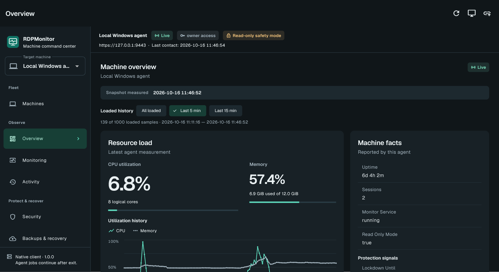

# RDPMonitor Desktop

Native Windows desktop administration with a resident Windows agent. Manage local computers, Windows servers and Windows guests from one application. Monitoring, RDP protection and scheduled backups belong to the agent, not the client window.

The client uses Flutter widgets, not a WebView. Telegram and the browser panel have been removed. Android/iOS platform sources use the same authenticated API; platform signing, real-device lifecycle and push-provider setup are separate deployment prerequisites.

**Windows preview · MIT open source · unsigned monitoring-only installer**

[Download the Windows preview](https://github.com/Mans230/RDPMonitor-Desktop/releases/tag/v1.0.0-preview.4) · [Install a VM with one CMD command](docs/DESKTOP-DEPLOYMENT.md#install-a-vm-with-one-cmd-command) · [Security](SECURITY.md)



The desktop redesign uses bundled Geist typography, slate/teal light and dark themes, grouped machine tools, explicit connection/access context, searchable fleet rows and loaded-history chart controls. It remains a native Flutter app with real agent data, not a browser wrapper or a dashboard mockup.

## What it manages

- Actual CPU/RAM/disks/network, timestamped charts, reports, temperatures when exposed, process/service/session inventory and diagnostics.
- Failed-login protection, blocks/subnets, RDP allow-lists, trusted-source lockdown, panic, port migration and hardening.
- Account administration, identity-safe process control, services, session screenshots/messages/launch/lock/logoff, confirmed power actions and bounded optional shell execution.
- ZIP/restic backups, sources/exclusions/schedules, VSS, hooks, retention, cloud OAuth/credentials, verified delivery, isolated restore/drills and encrypted off-host recovery exports.
- System imaging, complete image file sets, upload/verification and recovery instructions. A file or successful upload is not proof of bootability.
- Durable jobs/events/audit, resumable file transfer, individual device enrollment/renewal/revocation and typed configuration revisions.

See [feature coverage](docs/FEATURE-COVERAGE.md) for the disposition of all 87 documented legacy commands and [native operation reference](docs/COMMANDS.md) for executable forms and permissions.

## Architecture

The normal-user desktop client connects over TLS with an individually enrolled certificate. A constrained gateway talks to the privileged worker through a local ACL-protected named pipe. The worker owns durable jobs, validates capabilities and confirmations, and executes the retained Windows/backup engines. A separate signed-in user helper performs interactive actions; there is no session-zero screenshot or SYSTEM desktop fallback.

A local suite installation includes client and agent. The quick VM command installs a separate **agent-only** package: no desktop app on the guest. A guest agent manages Windows inside its VM; provider/hypervisor power control and VM provisioning are not included.

For machines behind NAT or on different networks, the agent and desktop both connect outward to a self-hosted HTTPS relay. The relay forwards opaque desktop-to-agent TLS bytes; the existing agent certificates, roles, confirmations and revocation remain authoritative. No VM inbound management rule or VPN is required. See the [implementation and trust-boundary plan](docs/RELAY-INSTALLATION-PLAN.md).

## Install a VM with one CMD command

An operator must first deploy the supplied relay with a domain and valid HTTPS. **This repository does not provide a publicly hosted relay.**

1. On your operator PC, extract the Windows preview ZIP and run `client\rdpmonitor.exe`. Keep its adjacent runtime files.
2. Open **Relay settings** from the connection menu. Save your relay's HTTPS origin and private administration key once; they go into OS-protected storage.
3. Choose **Add machine**, enter its name and optional group, and create the installation command. Accept the explicit unsigned monitoring-only preview notice, then choose **Copy CMD command**.
4. Inside the Windows VM, open **Command Prompt as Administrator** (CMD, not PowerShell), paste that one line and press Enter. No VM installer wizard, setup-code entry or second code is needed.
5. Keep Add machine open. The desktop verifies the encrypted agent identity and enrolls automatically. No VM address or manual fingerprint entry is required. Close and reopen Add machine to resume its protected pending installation.

The command downloads the complete background guest runtime, verifies the desktop-pinned SHA256, and silently installs boot-time worker/gateway services with a loopback-only listener and outward relay connection. It executes only the desktop's bundled public bootstrap code, not a downloaded script. No separate Python or Flutter installation is needed, and the operator desktop app is not installed on the guest. Normal CMD provisioning is always **monitoring-only/viewer**, including signed builds, and refuses an already installed machine rather than replacing its identity.

**The copied command is private.** Its base64url environment value contains independent registration and pairing capabilities; encoding is not encryption. Only the registration token reaches the relay. The pairing key authenticates the VM's encrypted identity envelope locally. The secret is passed through process environment into an administrator/SYSTEM-protected exchange, not PowerShell/native installer arguments or download URLs. Paste into an existing CMD window—never pass the private line as `cmd /c` arguments or publish it. Clipboard and CMD history can retain it.

For an already installed agent, use the matching native installer's advanced pairing/repair flow; do not rerun the fresh-machine command or reuse a consumed installation invitation. Desktop exit does not stop installed services.

The installer is a preview, not proof of an accepted deployment. **Installed SCM identities, reboot/logoff and clean-VM repair/uninstall remain unvalidated on a disposable VM.** Use a disposable Windows VM first. This is not a signed production release; do not bypass the separate production signature checks.

### Fleet workspace

- Machines are grouped in a searchable table with live/retained disk used, total and free space, contract expiry, renewal date and cost estimate. Edit a profile or choose **Edit renewal dates**; dates are local calendar days, costs use exact two-decimal amounts and an editable currency/billing period.
- Contract metadata stays in the client vault and survives device-certificate renewal. It does not charge a payment method, renew a provider contract or extend certificate access.
- **Backups**, **Recovery**, **Processes** and **Services** have separate sections. Related command groups show one, two or three natural-height cards according to the actual available content width.
- Use **Hide sidebar / Show sidebar** on wide windows; narrower windows use a navigation drawer. Tables scroll horizontally instead of hiding contract columns or overflowing.
- Advanced **Connect with code** remains available for already-installed agents and interrupted setup recovery. Issued identities are checkpointed before the final authenticated probe, so verification/save retries do not repeat enrollment.


For the relay's one-time deployment, native installer builds and the advanced direct connection method, see [deployment instructions](docs/DESKTOP-DEPLOYMENT.md).

## Run from source

Requirements: Windows x64, Python 3.14 for the pinned build environment, Flutter with **Dart 3.13.0 or newer within 3.x**, Visual Studio 2022 C++ build tools/Windows SDK **and ATL** for Windows native plugins. Use an elevated terminal for the agent and local pairing approval. Run the desktop as a normal user for ordinary administration.

```powershell
python -m venv .venv
.venv\Scripts\python -m pip install -r requirements.txt

# Safe evaluation: actual telemetry, no protection mutations or backup schedules.
.venv\Scripts\python -m agent serve --read-only --data-dir "$env:LOCALAPPDATA\RDPMonitorEvaluation" --port 9443
```

In a second elevated terminal:

```powershell
.venv\Scripts\python -m agent pair --data-dir "$env:LOCALAPPDATA\RDPMonitorEvaluation" --role owner
```

The local command prints a short-lived one-use code, agent ID and server certificate SHA256 fingerprint. Keep the code private. Compare the fingerprint through a trusted channel before enrolling.

Build/run the native client:

```powershell
cd clients\app
flutter pub get --enforce-lockfile
flutter run -d windows
# Or: flutter build windows --release
```

For this direct source-evaluation flow, choose **Advanced: direct HTTPS** from the connection menu, then enter `https://127.0.0.1:9443`, the locally verified fingerprint/code, a display name and device name. The client generates its key locally and stores credentials in OS-protected storage. Ordinary connections verify the enrolled CA, hostname and client certificate; no certificate-verification bypass is offered.

Use a short checkout path such as `C:\src\rdpmonitor` for Windows C++ builds. Deep temporary paths can exceed MSBuild's path limit. A substituted drive can shorten Windows builds, but Android/Kotlin builds should keep the project and Pub cache on the same drive to avoid cross-root incremental-cache failures.

For ordinary mutating operation, omit `--read-only` only on a machine you intend to administer. Prefer an isolated VM for first-run security/backup/imaging validation. The integrated `serve` command is for development; production uses the split boot-time services.

## Install and update

Production deployment uses an authenticated, Authenticode-signed package, a pinned publisher certificate and a signed coherent release manifest. It does not install Python/pip into an arbitrary user environment or execute unsigned downloaded scripts.

See [deployment, migration and recovery](docs/DESKTOP-DEPLOYMENT.md). Real publisher signing credentials are required to produce/install a signed release; unsigned local builds are not represented as trusted release installers.

`scripts/build-installer.ps1` wraps a complete package in the native Windows installation/code wizard. Production builds require the real publisher signing key and preserve authenticated package checks. The distinct `-UnsignedPreview` path requires affirmative preview consent and forces monitoring-only deployment and viewer enrollment; it is not a fallback for failed production verification.

Client startup, closing the application, enabling backup schedules, stopping services and removing an installation are distinct actions. Removal preserves data and firewall policy by default. Migration must run under the original Windows account when user-scoped legacy secrets need decryption; do not simply copy encrypted configuration to a new host.

Windows **Desktop settings** controls per-user sign-in startup, optional close to notification area, explicit hide and exit. Closing exits by default. A running Windows client continues refreshing while unfocused or hidden; the agent continues independently even after the client exits.

Relay mode listens only on loopback and needs outbound HTTPS/WSS to your relay. Advanced direct remote listening is separately scoped to a selected private/VPN interface and approved sources. Neither mode permits unrestricted public administration ingress.

## Security defaults

- No shared bot/panel password. Locally approved owner/operator/viewer device identities; roles are not selected by remote enrollment requests.
- Per-operation authorization and live capability checks. Shell execution, account changes, uploads and imaging remain deliberately gated.
- Short-lived single-use confirmations bind exact parameters, machine, device and configuration revision.
- Protected code/runtime installation, encrypted worker secrets/configuration/job snapshots, scoped file policy and attributable audit.
- Network timeout is not job cancellation. Inspect the durable job before retrying a mutation. Interrupted operations may have committed effects.
- Recovery passwords/keys must be stored off-host. DPAPI alone is not portable recovery material.

See [SECURITY.md](SECURITY.md).

## Notifications and mobile

Desktop/mobile local notifications are opt-in while the client is active. Persisted agent events remain the source of truth when the client is closed.

The trusted worker includes APNs/FCM sender integration and protected registrations/outbox. Enabling actual push needs valid provider credentials and an appropriately provisioned mobile app/token; credentials are never bundled in clients. Push is best effort, not guaranteed delivery. An external heartbeat observer is required if the deployment needs notification when an agent cannot contact anything at all.

Native mobile push-token acquisition/registration is not implemented in this Flutter client. Mobile background push therefore remains a separate implementation and real-device acceptance gate, not something enabled merely by entering provider credentials.

Android debug builds can be produced with `flutter build apk --debug` using an installed Android SDK/JDK. Production Android builds require your keystore. iOS build/signing/device verification requires macOS/Xcode and your Apple provisioning credentials. Platform source or successful compilation is not evidence of real-device delivery/recovery.

## Verification

```powershell
.venv\Scripts\python -m unittest discover -s tests -v
cd clients\app
flutter test
flutter analyze
```

Tests exercise policy, certificate/replay/revocation boundaries, durable jobs/revisions, encrypted persistence, upload isolation/integrity and backup/recovery errors without changing host firewall/accounts/power.

Latest Windows checks: **196 backend tests and 30 client tests passed**, including real CMD success/failure cleanup and a deterministic real-Windows pipe instance-gap regression; `flutter analyze` reported no issues, and the native Windows debug client built and ran.

The local integration smoke exercised the exact packaged worker and gateway executables over real named-pipe IPC, certificate enrollment, authenticated HTTPS telemetry/history, an overview job, duplicate-request identity, read-only denials and certificate revocation. The packaged hidden helper returned authenticated status for the signed-in session. IPC regressions cover OS-derived identity, concurrent clients, clean shutdown and protected worker-file ACLs. Snapshot reads use the persistent sampler; history projects bounded numeric measurements instead of repeating process inventories.

The native Windows UI was exercised against that agent, including CPU/core-count rendering, startup registry changes, close/hide/restore/exit, refresh while hidden and disconnected/stale states. A launch with development tools removed from PATH loaded its app-local Visual C++ runtime. These were local CLI processes, not an installed SCM/reboot test. Destructive policy changes, constrained service-account isolation, boot/logoff behavior, signed migration/update/rollback, off-host cloud recovery, image boot and mobile push still require the disposable VM/device gates in the deployment guide.

The redesigned UI was additionally exercised through real enrollment, live telemetry and loaded-history filtering. Light, dark and narrow-window layouts were inspected from native Flutter renderer captures; the screenshot above is actual agent data. RDP desktop/window capture remained inconsistent, so renderer captures were used rather than substituting a mockup. Clean-machine installed visual acceptance remains open.

The relay flow was additionally exercised against the actual broker CLI and bundled worker/gateway: native invitation creation and encrypted-code enrollment, real mTLS telemetry, a durable view job and duplicate-request identity, read-only/viewer denials, a streamed SHA256-verified chart, revocation on an unchanged live TLS socket, renewal, broker loss/reconnect without job replay, and desktop process exit/relaunch using the OS-protected route and renewed credentials. Windows ACL checks reproduced and fixed loss of gateway ancestor-descriptor access without granting access to worker files. Real selector sockets exercised hard-abort cleanup of a stalled reader while quotas remained reserved.

Preview 3 was exercised through native name/group entry, single-code creation, pending close/reopen, real broker registration and automatic pinned/mTLS enrollment without a return code. Actual disk telemetry, contract editing and certificate renewal retained exact dates/costs. Native captures verified two/three-column Backups cards, hidden/open sidebar and a narrow drawer. A deliberately failed final mTLS probe preserved the issued identity across dialog close/reopen and then saved it without another device issuance. A genuine pinned response that previously stayed pending beyond 58 seconds now timed out after 30 seconds.

Preview 4 exercised the actual native **Prepare CMD command**, explicit consent and **Copy CMD command** controls. The copied line was 4,359 UTF-16 characters and contained no private capability in child arguments. Native close/reopen resumed the same protected setup; a real HTTPS/WSS broker and frozen Windows worker/gateway completed encrypted automatic viewer enrollment and displayed live disk data with the requested name/group. Wide and narrow command dialogs were inspected. Guest-only packaging succeeded without Flutter, frozen command import worked with an OS-only PATH, and real native silent preflight rejected missing mode/consent, malformed capabilities and retained identity. Actual HTTPS binary downloads exercised SHA256 rejection and production publisher rejection without preview fallback or cache residue.


These were isolated local fixtures, not an installed SCM or public relay deployment. Earlier transport checks used explicit numeric-loopback HTTP; Preview 4 used a strict HTTPS fixture CA trusted only inside the development processes, without changing the Windows root store. Release clients and installers require valid HTTPS. Fixture provisioning used the native-verified service SID without registering a service. Container/Caddy/public HTTPS hosting, production publisher signing and clean-VM service installation/reboot remain external acceptance gates.

## Layout

- `clients/app/` — native Flutter Windows/Android/iOS application.
- `agent/` — contracts, worker runtime, versioned gateway, enrollment, storage, Windows/backup adapters, session helper and delivery.
- `relay/` — bounded single-process ASGI broker, durable hashed transport credentials and encrypted invitation protocol.
- `deploy/relay/` — Docker Compose/Caddy deployment; operator-owned DNS, HTTPS and administration key.
- `installer/` — guest-only silent CMD installation plus advanced native preview consent, repair and pairing.
- `rdp_monitor.py` — retained transport-independent Windows monitoring/protection engine; not a standalone bot entrypoint.
- `backup/app/` — shared ZIP/restic/rclone/restore engines; no separate desktop GUI or Telegram daemon.
- `scripts/` — service installation, signed build/update/rollback and legacy migration tooling.
- `tests/` — deterministic behavior regressions.

## License

[MIT](LICENSE). Retain dependency and external-tool license notices when distributing packaged runtimes. Disk2vhd, restic, rclone and cloud-provider requirements are separate from the client license.

This desktop project evolves [Mans230/RDPMonitor](https://github.com/Mans230/RDPMonitor) and retains its Windows monitoring/protection and backup engines. The bundled Geist typeface uses the [SIL Open Font License](https://github.com/Mans230/RDPMonitor-Desktop/blob/main/clients/app/assets/fonts/OFL.txt), separate from the project's MIT license; desktop binary packages also include `GEIST-OFL.txt`. The guest-only package does not bundle the Flutter desktop or its typeface.
